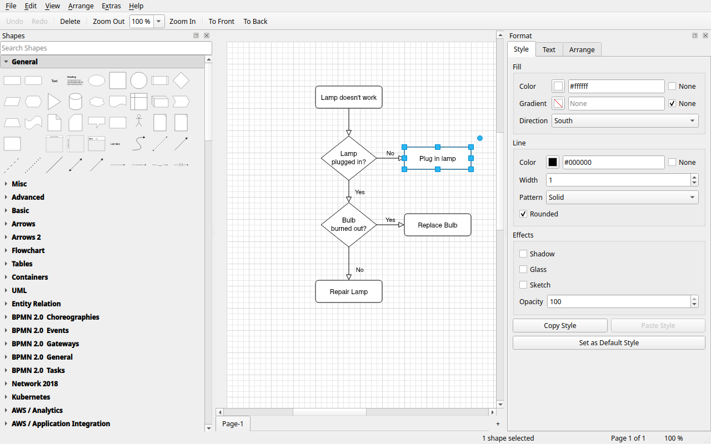

# Qraw

Qraw is a native Qt 6 / C++20 desktop diagram editor that reads and writes [draw.io](https://www.drawio.com/) files (`.drawio`, and bare `<mxGraphModel>` `.xml`) without losing anything it does not understand. It aims to replace draw.io Desktop for local work: no account, no network, no Electron.



More pictures: [main window](docs/screenshots/main-window.png), [palette search](docs/screenshots/palette-search.png), [dark theme](docs/screenshots/dark-theme.png), [dark diagram](docs/screenshots/dark-diagram.png), [containers and tables](docs/screenshots/containers-tables.png), [layouts](docs/screenshots/layout-flow.png), [Mermaid import](docs/screenshots/import-mermaid-flowchart.png), [export dialog](docs/screenshots/export-dialog.png), [welcome dialog](docs/screenshots/welcome-dialog.png). The screenshots are rendered offscreen, so they have no window decorations.

## What it does

- **Lossless round trip.** Unknown elements, attributes, style keys, comments and extensions survive a load and save in their original order; an untouched file saves back to equivalent XML, and the same model always gives the same bytes. Compressed and uncompressed pages, older payload forms and bare models are supported.
- **Editor.** Shape palette (18 palettes, about 3,500 shapes, search, favorites), pages, layers, groups, containers and swimlanes, tables, connectors with draw.io's routing, a Format panel, Edit Data, find and replace, shape libraries, templates, tree, flow, radial and other layouts, import from text, CSV and Mermaid, freehand drawing, light, dark and high-contrast themes, a dark diagram mode, undo and redo, and autosave with crash recovery.
- **Export.** PNG, JPEG, SVG and PDF, with an option to embed the editable diagram so the image can be opened and edited again.
- **Command line.** `qraw-cli --validate`, `--info`, `--convert` and `--export` work without a display.
- **Fast.** The canvas paints from tiles rasterised on worker threads; documents with 10,000 or 50,000 cells, or with dozens of embedded screenshots, stay interactive ([docs/BENCHMARKS.md](docs/BENCHMARKS.md)).

The full list is in [FEATURES.md](FEATURES.md).

## Status and limitations

Qraw 0.1.0 is the first release, and it is young software. **It is developed and used on Linux; macOS and Windows builds come from CI and have had far less testing.** Be careful with work that matters, and keep backups.

- The test suite (about 160 CTest entries) passes on Linux, and is clean under AddressSanitizer and UBSan. The editor's GUI tests run on Qt's offscreen platform with synthetic input; real-desktop behaviour (X11, Wayland, fractional scaling, input methods, screen readers) is not yet well exercised.
- Rendering is close to draw.io's but not identical: on a sample of 123 files, 98 are within 10 % of draw.io's own export on layout ([docs/FIDELITY.md](docs/FIDELITY.md)). Text differs slightly because the text engines differ.
- Not implemented: `.vsdx` import and export, PlantUML, math typesetting (`math=1` is kept in the file and shown as plain text), the `glass` effect, export as HTML, and some JavaScript-only draw.io shapes and vendor icon sets (they draw with a fallback). Mermaid import covers flowcharts and sequence diagrams only.
- Cloud storage, accounts, plugins, online search, AI features, collaboration and a web build are out of scope.
- The Windows and macOS packages are unsigned.

[ROADMAP.md](ROADMAP.md) has the status and what comes next, [KNOWN_ISSUES.md](KNOWN_ISSUES.md) every known gap, and [COMPATIBILITY.md](COMPATIBILITY.md) the feature matrix.

## Install

### From a package

`packaging/build-all.sh` builds an RPM (plus source RPM), a DEB and a single-file Flatpak bundle into `dist/` (ignored by git); `packaging/test-install.sh` installs each in a clean environment and smoke-tests it. CI builds the same packages. Details: [BUILDING.md](BUILDING.md#linux-packages).

| Format | File | Works on |
|---|---|---|
| RPM | `qraw-<version>-1.<dist>.x86_64.rpm` (and `.src.rpm`) | Fedora 44 (built and tested there); needs Qt 6.5 or newer, so other RPM distributions with Qt 6.5+ should work but are untested |
| DEB | `qraw_<version>_amd64.deb` | Debian 13 (trixie), Ubuntu 25.10, 26.04 and 26.10. Ubuntu 24.04 is **not supported**: it ships Qt 6.4 and the package refuses to install |
| Flatpak | `Qraw-<version>.flatpak` | Any distribution with Flatpak (KDE runtime 6.11, from Flathub); the manifest is in [packaging/flatpak/](packaging/flatpak/README.md), application id `io.github.newmca.qraw` |

Qraw is not on Flathub yet. There is no AppImage, by choice (the three formats above cover the Linux distributions, and an AppImage would mean bundling Qt and a second tool chain).

CI also builds a Windows installer and portable ZIP (x64) and a macOS `.dmg` and uploads them as workflow artifacts. They are not signed: Windows SmartScreen asks (More info, Run anyway) and macOS needs right-click, Open on first start. Details and how to build them yourself: [BUILDING.md](BUILDING.md#packages).

### From source

You need CMake 3.25 or newer, Ninja, a C++20 compiler (GCC 11, Clang 14 or MSVC 2022), Qt 6.5 or newer and zlib. [BUILDING.md](BUILDING.md) lists the packages for each platform and has the full build guide:

```sh
git clone https://github.com/newmca/qraw.git && cd qraw
cmake --preset release
cmake --build --preset release
ctest --preset release -j4
build/release/src/app/qraw                 # the editor
cmake --install build/release --prefix /usr/local   # optional: menu entry, icon, .drawio association
```

If the build is killed (the machine ran out of memory), limit the parallel jobs, for example `cmake --build --preset release -j4`.

## Using it

Pick a shape in the left palette (click to insert, drag to place, or search), click a shape to select it (drag to move, drag a handle to resize), hover a shape and drag one of its blue arrows to another shape to connect them, double click to edit a label, change fill, line and text in the Format panel on the right, and use Ctrl+Z / Ctrl+Y to undo and redo. File > Export As writes PNG, JPEG, SVG or PDF; "Include a copy of my diagram" keeps the file editable. Pages are the tabs below the canvas; Layers, Outline, Find and Cells are in the View and Edit menus.

On the command line:

```sh
qraw-cli --info diagram.drawio
qraw-cli --validate diagram.drawio          # exit 0: loads, 1: errors, 2: bad usage
qraw-cli --convert diagram.drawio --output plain.drawio --uncompressed
qraw-cli --export diagram.drawio --output diagram.png --scale 2
qraw diagram.drawio                         # open in the editor
```

`qraw` accepts the same flags as `qraw-cli`. The editor needs a display; without one put `QT_QPA_PLATFORM=offscreen` in front (the window is created but never shown), for instance to take a picture with `qraw --screenshot shot.png diagram.drawio`.

### Logs and crash reports

The GUI writes a log file, and a crash leaves a report; both are in the data folder `~/.local/share/Qraw/Qraw/` (macOS: `~/Library/Application Support/Qraw/Qraw/`, Windows: `%LOCALAPPDATA%\Qraw\Qraw\`; inside a Flatpak: `~/.var/app/io.github.newmca.qraw/data/Qraw/Qraw/`). **Help > Open Log Folder** opens `logs/`. Crash reports hold version, Qt, system and a stack trace but no document content: attach one to a bug report. After a crash the next start offers the autosaved documents. Details: [BUILDING.md](BUILDING.md#logging-crash-reports-and-recovery).

## Relationship to draw.io

Qraw is an independent C++ reimplementation of an editor for the draw.io file format. It is **not affiliated with, endorsed by or sponsored by JGraph Ltd. or diagrams.net**, and it contains no JavaScript. It was built by reading the file format and draw.io's open source code (Apache-2.0) and by comparing against draw.io's own output, so it is "clean-room" only in part: where a source file follows a draw.io function closely (many shape painters, edge routing, some operations), it is a port, and its header says `Port of <upstream path> (draw.io, Apache-2.0)`. Other parts, such as the sketch renderer and the tree, radial, flow and organic layouts, are our own algorithms. Some data is also derived from draw.io and redistributed under its own licences: the default style sheet, the shape (stencil) libraries, the sidebar palette definitions and the diagram templates. All of it is listed in [THIRD_PARTY.md](THIRD_PARTY.md). draw.io is a trademark of JGraph Ltd.

## Documentation

- [BUILDING.md](BUILDING.md): dependencies, presets, options, packages, tests and CI
- [CONTRIBUTING.md](CONTRIBUTING.md): code layout, the rules for changes, how to test
- [ARCHITECTURE.md](ARCHITECTURE.md) and [docs/design/](docs/design/): modules, the lossless model, the canvas pipeline
- [DECISIONS.md](DECISIONS.md): design decisions log
- [COMPATIBILITY.md](COMPATIBILITY.md): draw.io feature matrix; [FEATURES.md](FEATURES.md): what the program does
- [ROADMAP.md](ROADMAP.md), [KNOWN_ISSUES.md](KNOWN_ISSUES.md), [CHANGELOG.md](CHANGELOG.md)
- [docs/FIDELITY.md](docs/FIDELITY.md): how closely it matches draw.io's output; [docs/BENCHMARKS.md](docs/BENCHMARKS.md): timings
- [THIRD_PARTY.md](THIRD_PARTY.md): licences of dependencies and bundled assets

## License

Apache License 2.0, see [LICENSE](LICENSE) and [NOTICE](NOTICE). Bundled draw.io data is also Apache-2.0 (the stencil libraries with an additional field-of-use restriction) and the templates also CC BY 4.0; see [THIRD_PARTY.md](THIRD_PARTY.md). Qt is used under the LGPL-3.0, linked dynamically.

## Trademarks

Qt is a registered trademark of The Qt Company Ltd. and its subsidiaries. draw.io is a trademark of JGraph Ltd.; Qraw is not affiliated with it. All other trademarks are the property of their respective owners.
