# Rendering fidelity against draw.io

How closely does Qraw draw a diagram compared with draw.io itself? Measured by exporting the same files with both programs at the same settings and scoring the pairs. Regenerate everything with `tools/fidelity/run_fidelity.sh` ([tools/fidelity/README.md](../tools/fidelity/README.md)); no reference render and no draw.io binary is stored in the repository.

**In one line:** on 123 files Qraw is within 5 % of draw.io on layout for 78 files (63 %) and within 10 % for 98 (80 %); 25 files are above 10 % and nearly all of those have a cause that is named below. At the pixel level no file is exact: text is drawn by a different engine, so the median file has 27 % of its 2x2 blocks different. The first measurement had 66, 83 and 40 files in those three bands and a mean layout score of 12.0 %; it is now 8.7 %. [First round of fixes](#first-round-of-fixes) and [second round](#second-round-of-fixes) record what moved, the classes below describe what was found with their status, and [Current state](#current-state) says what remains and why.

## Method

| | |
|---|---|
| draw.io | Desktop 32.7.4 (`drawio-x86_64-32.7.4.AppImage`, SHA-256 `7d78c781...b222c`, checked against the release's `Files-SHA256-Hashes.txt` and `latest-linux.yml`), extracted, run as headless Electron |
| Qraw | `qraw-cli` from the `release` preset at the commit of the measurement |
| draw.io command | `env -u DISPLAY -u WAYLAND_DISPLAY drawio --ozone-platform=headless --disable-gpu -x -f png -s 1 -b 10 --timeout 120 -o <out> <dir>` (one Electron start for the whole folder, first page, opaque white, no sandbox flag needed) |
| Qraw command | `qraw-cli --export <file> --output <png> --scale 1 --border 10` (page 1, opaque white) |
| Sample | `tools/fidelity/sample.tsv`: 123 files, 113 from the corpus (`tests/corpus`: 59 generated files covering every family and 54 upstream templates from basic, business, charts, AWS, Azure, GCP, IBM, engineering, flowcharts, layout, maps, network, other, software, tables, UML, venn and wireframes) and 10 feature probes written for this run (`tools/fidelity/probes`: fills, shadows, gradients, opacity, dash patterns, 40 basic shapes, 40 label styles, 18 edge styles, 25 markers in three widths, line jumps, containers, sketch) |
| Fonts | Both programs resolve fonts through the same fontconfig: Helvetica gives Nimbus Sans, Arial gives Liberation Sans, `Times New Roman` Liberation Serif, `Courier New` Liberation Mono, Verdana and the default sans-serif Noto Sans, Georgia Noto Serif; the run records it in `fonts.txt` |
| Time | 166 s end to end from an empty output directory (draw.io 155 s, Qraw 2 s, scoring 4 s); 10 s when the draw.io PNGs exist |

### Scoring

Per file (`tools/fidelity/diff/fidelity_score.h`, a Qt tool with a self-test on synthetic images):

1. Both images are flattened over white and cropped to their content boxes (the bounding box of everything that is not white).
2. **Size mismatch** is the share of the larger content box that the two do not overlap when anchored at a corner. It measures bounds (geometry), not drawing.
3. The crops are padded to a common canvas and aligned top-left or centred, whichever differs less, then the candidate is nudged by up to one pixel in each direction (draw.io puts hairlines on half pixels and rounds bounds differently).
4. Blocks are averaged and compared in CIE L*a*b*; a block differs when CIE76 deltaE exceeds 10. **Pixel score**: differing 2x2 blocks among the blocks that hold content in either image, combined with the size mismatch. **Layout score**: the same on 8x8 blocks, which forgives text and antialiasing but still sees a missing, moved or differently drawn shape. Combined means `1 - (1 - share) * (1 - size mismatch)`.
5. Per file the run writes a composite (draw.io | Qraw | heat map; red: 2x2 blocks that differ, blue boxes: 8x8 blocks that differ) to the output directory.

Limits. The scores rank differences, they do not measure how a person sees them. Text is always different at the pixel level (draw.io lays HTML labels out in Chrome and rasterises through Skia, Qraw lays them out with Qt's rich text and rasterises with Qt's raster engine), so the pixel score is a floor of about 20 to 30 % even for a diagram that looks the same; read the layout score for "is it drawn right" and the pixel score for "how close are the pixels". One page, scale 1, light theme only. 123 files is a sample, not the corpus. The sketch style is random in draw.io and cannot match. Dark mode, other pages, transparent export, SVG and PDF output are not compared. The classes below are counted by feature presence in the sample (`classify.py`): a file with a cause class can also be off for other reasons, and the generic features (markers, orthogonal edges, rounded corners) correlate with the large diagrams, not with a defect.

## Overall numbers

| Metric | mean | median | p90 | max |
|---|---|---|---|---|
| Layout score | 8.7 % | 2.9 % | 22.6 % | 78.8 % |
| Pixel score | 28.2 % | 26.8 % | 55.3 % | 80.1 % |
| Size mismatch | 1.5 % | 1.0 % | 2.5 % | 25.1 % |

| Score up to | layout | pixel |
|---|---|---|
| 2 % | 45 of 123 | 5 of 123 |
| 5 % | 78 | 9 |
| 10 % | 98 | 22 |
| 25 % | 113 | 57 |
| 50 % | 117 | 105 |

Size: draw.io's content box is typically 1 to 3 px larger than Qraw's (for example 364x494 against 361x491 for a seven-shape flowchart). The strokes and the bounds are computed the same way in principle, so it is most likely the half-stroke and the rounding of the page origin (not diagnosed); it is not visible and not worth chasing. Mismatches above 5 % are real: `unicode-scripts` (25 %, text positions of right-to-left and wide scripts), `electrical_1` (10 %, edge routing) and `aws_3d` (9 %, shapes that are not drawn).

By family (mean layout score, files in brackets; the full table is `summary.md` of a run): venn 0.8 % (3), orgchart 1.2 % (2), charts 1.3 % (3), uml-sequence 1.7 % (2), uml-state 1.9 % (2), network templates 1.9 % (4), swimlanes 2.3 % (3), mockup 2.6 % (4), flowcharts 2.6 % (4), floorplan 2.9 % (2), bpmn 3.1 % (3), probes 3.7 % (10), edges 5.2 % (6), er-tables 7.4 % (4), uml-class 9.4 % (3), software 10.2 % (5), upstream/tables 11.9 % (2), basic 12.5 % (5), uml 13.5 % (5), labels 18.5 % (4), network (generated) 19.5 % (4), cloud 26.9 % (4) and 30.2 % (5 templates), upstream/engineering 61.1 % (1). What is left at the top is the unshipped stencils and images (class 6), sketch (7), edge routing (9) and the scripts of class 12. Probes (layout score): fills 5.2 %, basic shapes 9.2 %, labels 4.0 %, edge styles 5.4 %, waypoints 1.8 %, markers 0.6 %, marker sizes 2.0 %, line jumps 1.8 %, containers 4.3 %, sketch 6.4 %.

## The 20 worst files (layout score)

Now (`floor_plan`, once number 1, is at 0.7 %; `authority_matrix`, number 2, at 21.7 %).

| # | File | Layout | Pixel | Cause (class below) |
|---|---|---|---|---|
| 1 | cloud/aws/aws_3d | 78.8 % | 80.1 % | aws3d stencils missing (black blocks), isometric edges (6, 8) |
| 2 | cloud/ibm/ibm_microservices | 63.9 % | 72.1 % | images not shipped (grey placeholders), HTML blocks (6) |
| 3 | engineering/electrical_1 | 61.1 % | 67.2 % | edge routing (loops at the junctions), size 10 % (9) |
| 4 | network/star-topology | 55.6 % | 59.0 % | images not shipped (6) |
| 5 | basic/kanban | 54.2 % | 53.6 % | sketch: hatch fills missing, jiggle (expected) (7) |
| 6 | uml/sysml | 50.6 % | 59.4 % | `mxgraph.sysml.package` frame and the stencil set (6) |
| 7 | labels/unicode-scripts | 38.6 % | 69.7 % | text placement of right-to-left and wide scripts (12) |
| 8 | cloud/azure-web-app | 38.3 % | 52.2 % | images not shipped (6) |
| 9 | cloud/k8s-cluster | 28.3 % | 56.1 % | `mxgraph.kubernetes.icon2` icons not shipped (6) |
| 10 | cloud/aws-three-tier-web | 25.2 % | 24.3 % | AWS4 `resourceIcon` composites (known) |
| 11 | flowchart/edge-label-offsets | 23.0 % | 56.2 % | edge label offsets, text 1 px apart (not diagnosed) |
| 12 | labels/breaks-and-nesting | 22.8 % | 53.7 % | `
` rule position, list indent, inline font sizes (4) |
| 13 | software/git_flow_1 | 22.7 % | 56.6 % | line jumps and markers (13) |
| 14 | other/infographic_1 | 22.1 % | 24.8 % | gradient range, text weight |
| 15 | tables/authority_matrix | 21.7 % | 32.8 % | row heights (draw.io's rows are equally high, Qraw's header row is lower), text 1 px (5, fixed in the second round) |
| 16 | edges/edge-styles | 21.2 % | 43.1 % | edge shapes, isometric edge (8) |
| 17 | network/vlans | 19.8 % | 26.8 % | images not shipped (6) |
| 18 | uml-class/associations | 19.8 % | 42.9 % | rows and rules, text 1 px (1) |
| 19 | whiteboard/callouts-and-basics | 17.4 % | 50.0 % | callout perimeters, glass (11) |
| 20 | cloud/gcp-pipeline | 15.8 % | 29.1 % | images not shipped (6) |

## Difference classes

"Files" counts sample files that use the feature; "over 10 %" those among them with a layout score above 10 %. A class is a cause that can be fixed or accepted; the crops (draw.io left, Qraw right) are in `docs/fidelity/`.

### 1. Text sits lower than in draw.io (every file with labels): fixed in the first round

Qraw placed a text line 1 to 5 px lower than draw.io, about 0.1 x the font size (4 to 5 px at 40 px, 1 to 2 px at 12 px); the heat maps showed it as a red band on every text. Cause, found with a test sheet exported by both programs (3 vertical alignments, 1 and 3 lines, 6 sizes, 5 font families, HTML and plain labels): Qt keeps the font's ascent above the first baseline whatever the line height (and a font such as Nimbus Sans has an ascent of 1.075 em), where draw.io puts the baseline
- for HTML labels where the CSS line box does: `line-height: 1.2`, the leading above and below the glyphs equal, so the first baseline is `1.2 x size / 2 + (ascent - descent) / 2` below the top of the block, and a block is as high as its lines;
- for plain labels where `mxSvgCanvas2D.plainText` does: the block is `size + (lines - 1) x round(1.2 x size)` high, its first baseline `size - 1` below the top, and a bottom anchored block one pixel higher. Nothing depends on the font.

`LabelPlacement` (`text_layout_cache.h`) now moves the document accordingly, and the display list, the dirty bounds and `labelTextRect` use the same top. Margins above the first and below the last block, which Qt drops and the label box of a browser keeps, are added back; the line pitch of plain text is `round(1.2 x size)` exactly. On the test sheet (180 label placements) the mean difference to draw.io went from 4.5 px (plain) and 2.7 px (HTML) to 0 and 0.7 px; the HTML remainder is up to 3 px for Verdana and Courier, for which Chrome picks another font file than fontconfig gives Qt (the run's `fonts.txt` is what fontconfig says, not what Chrome uses). Tests: `tst_render_label_placement`. 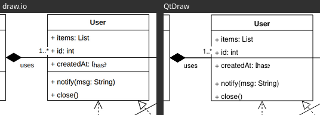

### 2. `shape=rect` and other unregistered shape names (4 files, 4 over 10 %, mean 44 %): fixed in the first round

draw.io draws a shape name it has no painter for as the default rectangle (`mxCellRenderer.getShapeConstructor` falls back to `defaultVertexShape`); Qraw handed such shapes to its placeholder painter (a rectangle with a folded corner) and logged "unknown shape rect". `shape=rect` is common in templates (84 cells in 4 sample files). Now `ShapeRegistry::isUpstreamOnly` lists the names draw.io can paint and Qraw cannot yet (`xor`, `sumEllipse`, `mxgraph.*` stencils, ...): those keep the placeholder and the diagnostic, every other unregistered name is the plain rectangle. `eip` went from 24.3 % to 1.6 %. Tests: `tst_render_page_view`, `tst_render_shapes`. 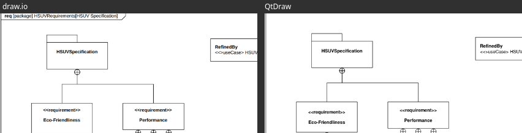

### 3. Floor plan `wallU` (3 files use floor-plan walls, 1 over 10 %, worst 88 %): fixed in the first round

`mxgraph.floorplan.wallU` is a JavaScript painter (`shapes/mxFloorplan.js`) that draws a U-shaped band of `wallThickness`; Qraw did not know it and its fallback painter filled the whole box (in `floor_plan` a 1210x2456 box was a black page). Ported (`shapes_floorplan.cpp`); `floor_plan` went from 88.4 % to 0.7 %. Test: `tst_render_shapes_js`. 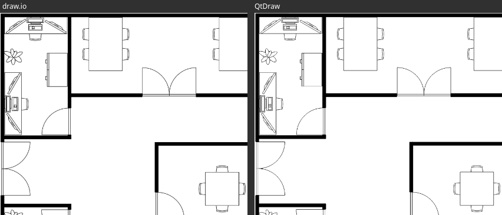

### 4. A line break at the end of a block, and HTML block elements (12 files, 6 over 10 %): mostly fixed in the first round

- Fixed: `
text 
` (a trailing ` ` ends the line in a browser and adds nothing) drew an extra empty line in Qraw (`database_2`: 10 rows pushed apart). `makeRichText` now drops a ` ` that ends a block after content (a lone ` ` is still a blank line, and only one of two is dropped); `sanitizeHtml` itself is unchanged (it stays idempotent). `database_2` 24.1 % to 9.6 %.
- Fixed: block margins. Qt's HTML importer uses absolute margins (12 px around `
`, 18/12 around `<h1>`, ...), draw.io's browser uses em of the element's own font size (`p` 1em, `h1` .67em, `h2` .83em, `h3` 1em, `h4` 1.33em, `h5` 1.67em); a block that has the importer's defaults gets the browser's, and the margin above the first and below the last block, which a browser's label box keeps, counts. `timeline_2` (`<h1>` over `
` in 16 cells) 23.2 % to 6.5 %. The test sheet (13 block combinations at 9, 12 and 16 px) is within 1 px apart from `
`.
- Fixed: `
` took a whole line and sat in the wrong place: it is a 2 px rule with .5em above and below now; the gaps match draw.io, the rule itself sits about 4 px higher than draw.io draws it inside the gap, and Qt paints it black where draw.io paints a thin grey inset line (open).
- Open: list indentation (`<ul>` text starts 3 px further right: 32 against 29 px at 12 px), `text-align` on inner `div`s (draw.io's label is shrink-to-fit, so "left para" and "right para" stay close together), and the hairline colour and position of `
` (Qt paints the rule itself, in black, in the middle of a fixed-height block). Not done; they are three or four pixels in a handful of labels (see [Current state](#current-state)). 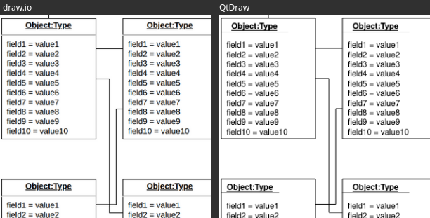 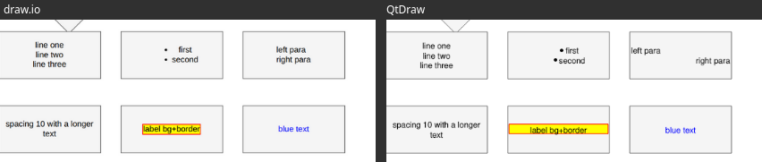

### 5. HTML tables in labels (3 files, 3 over 10 %, mean 38 %): fixed in the second round

`<table width="100%" height="100%">` with row background colours, cell padding and `border-collapse` (authority matrix, PERT, an ER table): Qraw's table was as wide as its text, so the header collapsed to the left. Three causes, each found by looking at what Qt's HTML importer keeps (`QTextTable::format()` after `setHtml`):

- Qt reads a table's size and cell padding only from the attributes (`width`, `height`, `cellpadding`, `border`); the sanitizer dropped them and Qt ignores `style="width: 100%"`. The sanitizer now keeps the numeric `width`, `height`, `border`, `cellpadding` and `cellspacing` of a `<table>` and writes the size of its `style` also as attributes (browsers read either, the output stays idempotent).
- A table in a box with `overflow=fill` is as wide and as high as the box in draw.io (its text div has the box's size). The layout is now done at the box width for such labels (`fillsBox`), and since Qt's layout has no table height, the extra height is shared between the rows through their cells' padding (`fillTables`; a cell without padding of its own starts from the table's `cellpadding`). Part of the layout cache key.
- A browser centres cell content vertically (`td` inherits `vertical-align: middle` from `tr`); Qt's importer puts it at the top. Cells that do not set their own alignment are centred (`useBrowserCellAlignment`).

`authority_matrix` went from 73.6 % to 21.7 %, `pert_1` from 20.4 % to 5.3 %, the ER table from 22.1 % to 14.6 %. What is left in them: draw.io's rows are all equally high (Qraw's header row stays lower than the body rows) and text sits 1 px off. Tests: `tst_render_html_table_label` (fills the box, the red row spans the width, other labels keep their ideal width, cells centred), `tst_render_rich_text` (`tableSizeAttributes`). 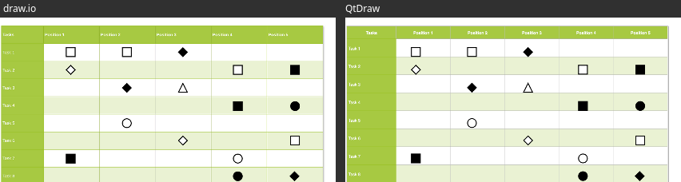

### 6. Stencil sets and images that are not shipped (13 + 8 files, 8 + 5 over 10 %, means 22 % and 26 %)

`aws3d` (`stencils/aws3d.xml` and `mxAWS3D.js`), `bootstrap`, `archimate3`, `ios7ui`, the remaining `mockup` parts and `kubernetes.icon2` are not in the vendored data, and `img/lib` images are not bundled; Qraw draws a grey box with a cross for an image and its fallback painter for a shape, which for `fillColor=#000000` is a black block (`aws_3d`). Known (KNOWN_ISSUES.md, "Rendering gaps"; ROADMAP: vendor icon add-ons). 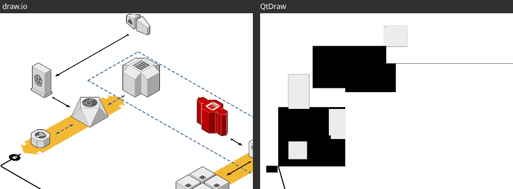 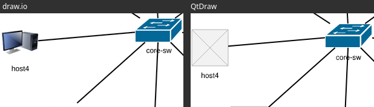

### 7. Sketch and fill styles (5 + 2 files)

Sketch jiggle is random in draw.io and cannot and should not match (expected, not a defect): `sketch=1` 5 files, `comic=1` as well. What is missing is the **pattern fill**: with `sketch=0` and `fillStyle=hatch` (also `cross-hatch`, `dots`, ...) draw.io paints an SVG pattern (`Editor.isPatternFillStyle`), Qraw a plain fill; in sketch mode the hachure lines of `kanban` are missing. 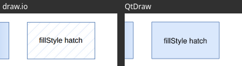 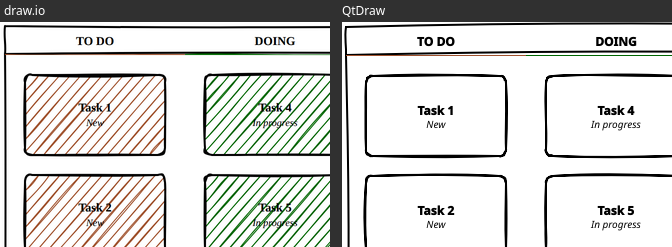 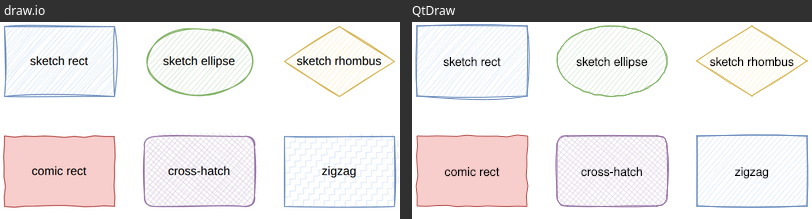

### 8. Edge shapes and the isometric edge style (3 + 3 files, 2 + 2 over 10 %)

`shape=flexArrow`, `link` and `arrow` edges are drawn as plain connectors (Qraw logs it); `edgeStyle=isometricEdgeStyle` is a straight line instead of draw.io's two-segment isometric route. 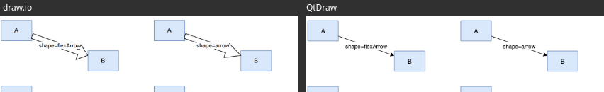 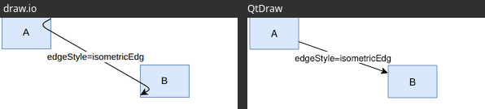

### 9. Edge routing (not counted: needs a per-edge comparison)

`electrical_1` (61 %, size mismatch 10 %): edges that end on a shape with `exitX`/`entryX` constraints get extra loops at the junction and a diagonal to `B`; the same edges in draw.io are orthogonal. 22 files use exit/entry constraints, 7 are over 10 %; the others route identically in the files looked at. Not diagnosed further. 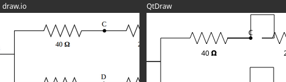

### 10. Shadows (15 files, 7 over 10 %)

`shadow=1` is a soft, light, slightly larger shadow in draw.io's PNG and a hard offset copy in Qraw. The sources in the clone only create a hard offset copy (`mxSvgCanvas2D.createShadow`), so the blur comes from the export path outside the clone; the cause is not visible from here. 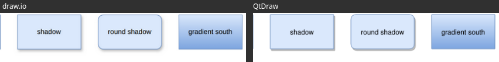

### 11. Glass and label backgrounds (2 + 14 files)

`glass=1` is not drawn (a known gap). `labelBackgroundColor`/`labelBorderColor`: Qraw pads the background box more than draw.io, which hugs the text. 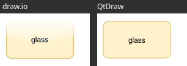 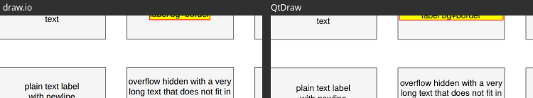

### 12. Right-to-left and wide scripts (6 files, 2 over 10 %)

In `unicode-scripts` the labels of non-Latin scripts sit at other x positions and the diagram is 25 % wider; Latin text in the same file is fine. Not diagnosed further. 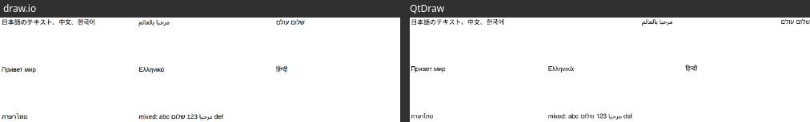

### 13. Hairlines and markers (generic, 56 files use non-default markers)

Thin strokes land on half pixels in draw.io and on pixel centres here, and arrowheads are about a pixel smaller in Qraw (`classic`, `block`). The probe with 25 markers in three widths has a layout score of 0.6 % and a pixel score of 63 %: every marker is there and the right shape, the pixels differ by antialiasing. Line jumps (arc, gap, sharp, line) match in shape: the probe's layout score is 1.8 %. 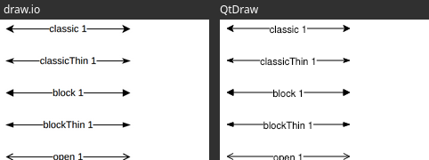

### Without a difference

Fills, gradients (all four directions, with flip), opacity, `fillOpacity`/`strokeOpacity`/`textOpacity`, dash patterns, `fixDash`, stroke widths up to 8, `arcSize` and `absoluteArcSize`, rotation, the 40 basic shapes of the probe except the Shapes.js ones, fonts and font styles (Helvetica, Arial, Times, Courier), label positions, wrapping and rotation, vertical text, orthogonal, elbow, entity-relation, segment and curved edges, loops, waypoints, every arrow marker, line jumps, swimlanes, nested containers, collapsed cells, the BPMN, UML, ER, Cisco and floor-plan stencils that are shipped, and the Venn and chart templates are drawn as draw.io draws them to within the pixel-level text difference (probe layout scores: fills 5.2 %, labels 5.5 %, edge styles 5.4 %).

## First round of fixes

Same 123 files, same draw.io PNGs (a second draw.io export from scratch gave identical scores except `sketch-comic`, whose sketch jiggle is random, by 0.2 points of the pixel score: the measurement noise on the layout score is below 0.1 point, and everything below is larger than that).

| | before | after |
|---|---|---|
| Layout score, mean / median | 12.0 % / 4.4 % | 9.3 % / 2.9 % |
| Pixel score, mean / median | 30.6 % / 29.1 % | 28.7 % / 26.8 % |
| Files within 5 % / 10 % layout | 66 / 83 | 78 / 97 |
| Files above 10 % layout | 40 | 26 |
| Files better / worse by more than 0.5 points of layout | | 51 / 3 |
| Files better / worse by more than 1 point of pixel | | 44 / 1 |

Largest gains (layout score, before to after): `floor_plan` 88.4 to 0.7 (class 3), `wireframe_1` and `home_page_1` 30.2 to 7.1, `eip` 24.3 to 1.6, `blog_1` 28.7 to 9.4, `aws_1` 23.5 to 4.5 (classes 1, 2 and 4 together; `eip` is mostly class 2), `timeline_2` 23.2 to 6.5 (4), `database_2` 24.1 to 9.6 (4), `basic/classes` 15.3 to 1.2 (1), `uml-class/associations` 26.3 to 19.8 (1), the labels probe 5.5 to 4.0 (1).

Files that got worse, all investigated (layout score before to after; none by more than 1.3 points): `gcp-pipeline` 14.5 to 15.8 (pixel score better by 3.6), `pert_1` 19.2 to 20.4, `authority_matrix` 72.5 to 73.6, `sysml` 50.1 to 50.6, `traffic-light` 1.8 to 2.3, `edge-label-offsets` 22.7 to 23.0 (pixel 52.4 to 56.2), `sequence_1` and `datacenter-subnets` by 0.2. The first three and `sysml` are dominated by causes that are not fixed yet (HTML tables, images, the sysml stencil set), and the text in them moved by 1 px across an 8x8 block boundary (Chrome and Qt use different font files for the same family, so 1 px at some sizes remains); `edge-label-offsets` and `traffic-light` are one pixel of text position as well. No shape or edge moved in any of them.

## Second round of fixes

Same 123 files and the same draw.io PNGs. Layout score mean 9.3 % to 8.7 %, median 2.9 % unchanged, files within 10 % 97 to 98, above 10 % 26 to 25. Three files changed by more than the noise, all better: `authority_matrix` 73.6 to 21.7, `pert_1` 20.4 to 5.3, the ER table label 22.1 to 14.6 (class 5); no file got worse; the goldens did not change. Re-run from the existing PNGs in 10 s.

Not done in this round, and why, in the next section.

## Current state

Two rounds of fixes dealt with what was measured: classes 1 to 4 in the first and class 5 in the second. What was not fixed, in the order of the original plan, with the reason:

| Class | State | Why it remains |
|---|---|---|
| 4 (open items), `
`, list indent, inner `text-align` | open | 3 to 4 px in a few labels; the rule is painted by Qt's layout and would need a custom block painter, and the shrink-to-fit label of a browser has no counterpart in `QTextDocument` |
| 6 stencil sets and images not shipped | not done, by design | data, not code: needs the vendor icon add-ons (ROADMAP); the pruned upstream clone does not contain `aws3d.xml` or `img/lib` |
| 7 pattern fills, sketch hachure | not done | `sketch=1` jiggle is random in draw.io and cannot match; the pattern fill (`fillStyle=hatch`, `dots`, ...) is a self-contained port left for a later package |
| 8 `flexArrow`, `link`, `arrow` edges, isometric edge style | not done | ports of `FlexArrowShape` and `mxEdgeStyle.IsometricConnector`; 3 + 3 files |
| 9 edge routing of `electrical_1` | not diagnosed | one file, needs a per-edge comparison with `mxEdgeStyle` |
| 10 soft shadows | not done | the blur comes from the export path outside the cloned sources; a guess would tune Qraw to one renderer |
| 11 glass, label background padding | not done | glass is a known gap; the padding is 1 to 2 px |
| 12 right-to-left and wide scripts | not diagnosed | one file; font choice differs for non-Latin scripts |
| 13 hairlines, marker size | accepted | one pixel, no visible difference |
| Font availability | accepted | Chrome and Qt pick different font files for the same family (Verdana, Courier): 1 px of text position |

The pixel score stays at a median of 27 %: two text rasterisers never agree to the pixel, so it is a floor, not a defect count. To re-run: `tools/fidelity/fetch_drawio.sh <dir>` once (about 100 MB), then `tools/fidelity/run_fidelity.sh <dir> build/fidelity` (3 minutes from scratch, 10 s with the draw.io PNGs cached) and `tools/fidelity/make_crops.sh build/fidelity` to refresh `docs/fidelity/`. A future package starts from the table above; classes 7 and 8 have the best gain per day of work.

